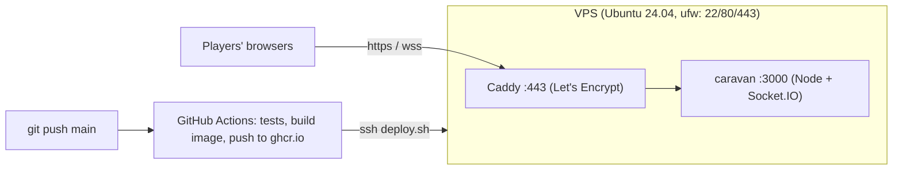

# Deploying Caravan

**Hosting:** a small Linux VPS in Europe (recommended: **Hetzner Cloud**, about €5–6/month) runs two containers:

- the game (the Docker image built from this repo);
- **Caddy**, which handles HTTPS automatically and passes WebSockets through.

**Deployments:** every push to `main` runs the tests, builds the image, publishes it to GitHub Container Registry and deploys it over SSH (`.github/workflows/deploy.yml`).

**Domain:** the free hostname comes from **DuckDNS** (`yourname.duckdns.org`). You can switch to your own domain later by changing one variable.



## Why this setup

| Need | How it is handled |
|---|---|
| Games live in memory and WebSockets stay open | A real always-on machine with a single instance. Nothing sleeps and there are no cold starts. Platforms that scale to zero on their free tiers would drop games in progress. |
| Players mostly in Europe | Hetzner data centers in Germany or Finland, roughly 15–40 ms from France. |
| Budget of a few euros a month | The smallest Hetzner server comfortably handles hundreds of simultaneous players: the game uses about 50 MB of RAM. |
| No server babysitting | cloud-init configures the machine; security updates install automatically; containers restart by themselves; the TLS certificate renews itself. |
| Deploys without killing games | `deploy.sh` waits up to 10 minutes for running games to finish before switching versions. If it has to restart anyway, players get a notice. |

**Alternative:** OVHcloud VPS-1 (data centers in France, similar price). The steps are identical, because everything below works on any Ubuntu 24.04 VPS that accepts cloud-init "user data".

> [!NOTE]
> VPS prices rose in 2026. Check the current price of the cheapest x86 plan with an IPv4 address (Hetzner CX23, or CPX/CX if out of stock). If you pick an **ARM** server (CAX), set the repository variable `IMAGE_PLATFORMS=linux/arm64`.

---

## One-time setup (about 20 minutes)

### 1. SSH keys

Run these on your machine:

```bash
# Your personal key (skip if ~/.ssh/id_ed25519 already exists)
ssh-keygen -t ed25519 -C "you@laptop"
# A dedicated key for GitHub Actions to deploy with
ssh-keygen -t ed25519 -f ~/.ssh/caravan_deploy -N "" -C "github-actions"
```

### 2. Create the server

1. Sign up at <https://console.hetzner.cloud>, then create a project.
2. **Add Server** with these choices:
   - **Location:** Falkenstein or Nuremberg (Germany), or Helsinki.
   - **Image:** Ubuntu 24.04.
   - **Type:** Shared vCPU, x86, cheapest available (CX23).
   - **Networking:** IPv4 + IPv6.
   - **SSH keys:** add `~/.ssh/id_ed25519.pub`.
   - **Cloud config:** paste [`deploy/cloud-init.yaml`](cloud-init.yaml) after replacing the two `ssh-ed25519 AAAA_REPLACE…` lines with the contents of `~/.ssh/id_ed25519.pub` and `~/.ssh/caravan_deploy.pub`.
   - Backups are not needed: the server holds no data.
3. Create the server and note its **IPv4 address**. Wait about 3 minutes for cloud-init to finish, then check:

```bash
ssh deploy@<IP> 'docker version --format "{{.Server.Version}}" && sudo ufw status && ls -ld /opt/caravan'
```

### 3. Free hostname (DuckDNS)

1. Sign in at <https://www.duckdns.org> (for example with GitHub).
2. Create a subdomain such as `caravan-yourname`, set its **current ip** to the server's IPv4 address, and click **update ip**.
3. Check that it resolves: `dig +short caravan-yourname.duckdns.org` should print the IP.

### 4. GitHub repository

Create an empty repository on GitHub (private or public), then push:

```bash
git remote add origin git@github.com:<you>/<repo>.git
git push -u origin main
```

In **Settings → Secrets and variables → Actions**, add:

| Kind | Name | Value |
|---|---|---|
| Secret | `DEPLOY_HOST` | the server IPv4 |
| Secret | `DEPLOY_SSH_KEY` | contents of `~/.ssh/caravan_deploy` (the private key) |
| Secret | `DEPLOY_KNOWN_HOSTS` | output of `ssh-keyscan -t ed25519 <IP>` |
| Variable | `DOMAIN` | `caravan-yourname.duckdns.org` |
| Variable (optional) | `IMAGE_PLATFORMS` | `linux/arm64` only for ARM servers |

### 5. Deploy

Push to `main`, or go to **Actions → CI / Deploy → Run workflow**. The workflow runs in about 5 minutes:

1. **test**: typecheck, unit and integration tests, then end-to-end tests in a real browser.
2. **image**: builds and pushes `ghcr.io/<you>/<repo>:<commit-sha>` and `:latest`.
3. **deploy**: copies `docker-compose.yml`, `Caddyfile` and `deploy.sh` to `/opt/caravan`, then runs `deploy.sh`, which pulls the image, waits for running games to finish and restarts the stack.
4. **smoke test**: requests `https://$DOMAIN/healthz`.

The first deploy also obtains the HTTPS certificate, which takes a few seconds. The game is then live at **https://caravan-yourname.duckdns.org**.

You can also run the full browser test suite against the live site:

```bash
E2E_BASE_URL=https://caravan-yourname.duckdns.org npm run e2e
```

---

## Day-to-day operations

| Task | Command |
|---|---|
| Live logs | `ssh deploy@<IP> 'cd /opt/caravan && docker compose logs -f --tail 100'` |
| Status / players online | `curl https://<DOMAIN>/healthz` |
| Roll back | Re-run an older successful workflow run, or `ssh deploy@<IP> 'cd /opt/caravan && DOMAIN=<DOMAIN> CARAVAN_IMAGE=ghcr.io/<you>/<repo>:<old-sha> ./deploy.sh'` |
| Deploy now without waiting for games | `WAIT_IDLE_MAX=0` in front of `./deploy.sh` |
| OS updates | Security updates are automatic. Run `sudo apt upgrade && sudo reboot` now and then; the containers come back by themselves. |
| Use your own domain later | Point an `A` record at the server IP, then change the `DOMAIN` variable and re-run the workflow. Caddy fetches the new certificate. |

## Trying the production stack locally

```bash
docker build -t caravan:test .
mkdir -p /tmp/caravan-stack && cp deploy/{docker-compose.yml,Caddyfile,deploy.sh} /tmp/caravan-stack/ && cd /tmp/caravan-stack
HTTP_PORT=8080 HTTPS_PORT=8443 SKIP_PULL=1 DOMAIN=http://localhost CARAVAN_IMAGE=caravan:test ./deploy.sh
# → http://localhost:8080, and from the repo: E2E_BASE_URL=http://localhost:8080 npm run e2e
```
