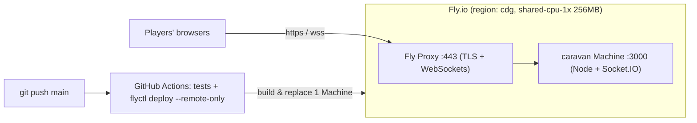

# Deploying Caravan to Fly.io

**Hosting:** a single always-on **Fly Machine** (`shared-cpu-1x`, 256 MB RAM) in Europe (`cdg` – Paris), about **$2.19/month** (~€2/month). Fly's built-in proxy handles HTTPS (TLS certificates), HTTP→HTTPS redirects and WebSocket upgrades automatically.

**Deployments:** every push to `main` runs the full test suite, builds the Docker image on Fly's remote builder, and deploys the Machine via [`deploy.sh`](deploy.sh) (`.github/workflows/deploy.yml`).

**Domain:** Fly.io gives your app a free HTTPS address (`https://<app-name>.fly.dev`) automatically. You can attach your own custom domain later with `fly certs add`.



## Why this setup

| Need | How it is handled |
|---|---|
| Games live in memory and WebSockets stay open | `--ha=false` + `auto_stop_machines = 'off'` + `min_machines_running = 1` in [`fly.toml`](../fly.toml) keeps exactly **one** Machine running 24/7. No scale-to-zero sleep, no cold starts, and WebSockets never hit the wrong instance. |
| Players mostly in Europe | `primary_region = 'cdg'` (Paris) – low latency across Western Europe (other EU options: `ams`, `fra`, `lhr`). |
| Minimal cost for an always-on server | `shared-cpu-1x` with 256 MB RAM runs around **$2.19/month** continuously. The Node server uses ~50 MB of RAM. |
| Zero server babysitting | No Linux server to patch, no firewall, no Caddy or DuckDNS to configure. Fly Proxy terminates TLS and renews certificates automatically. |
| Deploys without killing games | [`deploy.sh`](deploy.sh) checks `/healthz` and waits up to 10 minutes (`WAIT_IDLE_MAX`) for running games to finish before replacing the Machine. If it restarts during a game, `kill_signal = 'SIGINT'` gives the server time to warn players. |

> [!NOTE]
> Fly.io does not have an ongoing free tier for new accounts (there is a short trial, then pay-as-you-go billing requiring a card). Running one `shared-cpu-1x` (256 MB) Machine 24/7 costs roughly $2.19/month plus minimal bandwidth ($0.02/GB after free allowance). Fly does not charge extra for open WebSocket connections.

---

## One-time setup (about 10 minutes)

### 1. Install `flyctl` and sign in

On your machine:

```bash
curl -L https://fly.io/install.sh | sh
fly auth signup   # or: fly auth login
```

### 2. Create the Fly app (without deploying yet)

App names on Fly.io are globally unique (they become `<app-name>.fly.dev`), so pick a unique name instead of `caravan-card-game` if it is already taken:

```bash
fly launch --no-deploy --copy-config --name caravan-yourname --region cdg --ha=false
```

- `--copy-config` keeps the settings from [`fly.toml`](../fly.toml) (and updates `app = '...'` to your chosen name).
- `--ha=false` ensures Fly provisions **1** Machine instead of 2 (important both to avoid splitting in-memory games across two servers and to keep billing at ~$2.19/month).

Commit the updated `app = '...'` line in `fly.toml` if `fly launch` changed it (or keep `fly.toml` as-is and set the `FLY_APP` GitHub variable below).

### 3. Generate a deploy token

Create an app-scoped deploy token for GitHub Actions:

```bash
fly tokens create deploy -x 999999h
```

Copy the entire token printed to the terminal (starts with `FlyV1 ...`).

### 4. Configure GitHub Actions

In your GitHub repository under **Settings → Secrets and variables → Actions**, add:

| Kind | Name | Value |
|---|---|---|
| Secret | `FLY_API_TOKEN` | the `FlyV1 ...` token from step 3 |
| Variable (optional) | `FLY_APP` | your Fly app name (only needed if it differs from `app = '...'` in `fly.toml`) |

### 5. Deploy

Push to `main`, or go to **Actions → CI / Deploy → Run workflow**. The workflow runs in about 4–5 minutes:

1. **test**: typecheck, unit and integration tests, then end-to-end tests in Chromium.
2. **deploy**: runs `./deploy/deploy.sh`, which checks `/healthz` for active games, builds the Docker image remotely on Fly.io, replaces the single Machine (`--ha=false`), and verifies `/healthz` returns 200 OK.

Your game is live at **`https://<app-name>.fly.dev`**.

You can also run the full browser test suite against the live deployment:

```bash
E2E_BASE_URL=https://caravan-yourname.fly.dev npm run e2e
```

---

## Day-to-day operations

| Task | Command |
|---|---|
| Live logs | `fly logs` |
| App & Machine status | `fly status` |
| Players / games online | `curl https://<app-name>.fly.dev/healthz` |
| Deploy manually from your laptop | `./deploy/deploy.sh` |
| Deploy right now without waiting for games | `WAIT_IDLE_MAX=0 fly deploy --remote-only --ha=false` |
| Roll back to a previous image | `fly releases --image` then `fly deploy --image registry.fly.io/<app-name>:<tag> --ha=false` |
| Add your own domain later | `fly certs add caravan.example.com` (then add the CNAME/A records Fly prints) |
| Check current costs / usage | `fly dashboard` |

## Testing the container locally

The same `Dockerfile` runs on Fly.io. To verify it locally before pushing:

```bash
docker build -t caravan:test .
docker run --rm -p 3000:3000 caravan:test
# → http://localhost:3000, health check at http://localhost:3000/healthz
```
